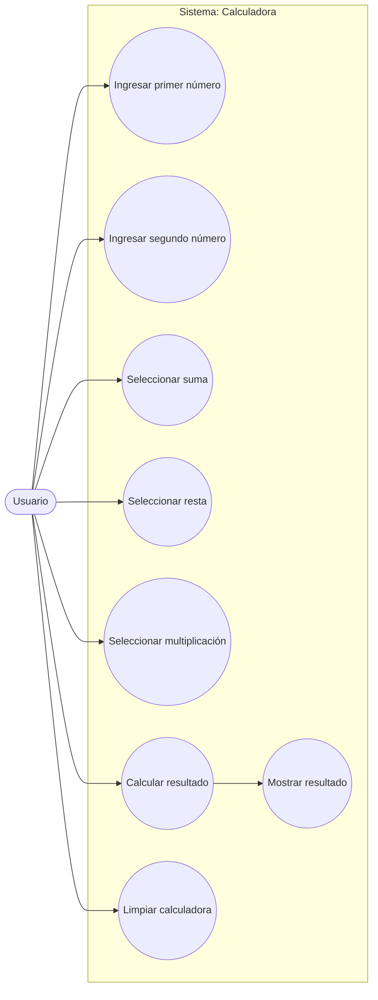
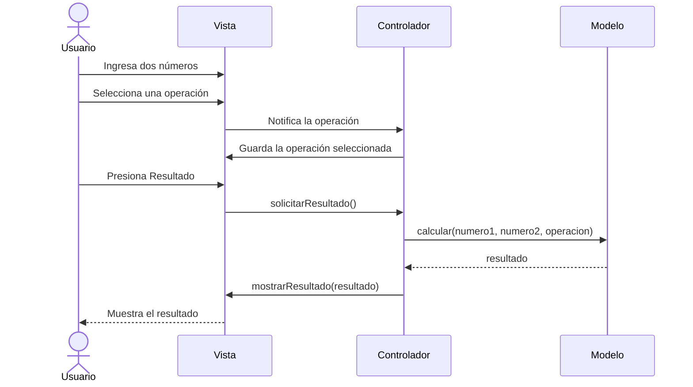
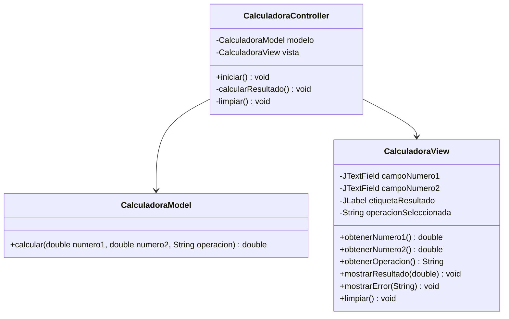

# Calculadora MVC en Java

Aplicación de escritorio desarrollada en Java con **Swing** y organizada con el patrón **Modelo-Vista-Controlador (MVC)**.

## Video de explicacion
[Ver video de la calculadora](https://alumnosuady-my.sharepoint.com/:v:/g/personal/a22204072_alumnos_uady_mx/IQCDDbkOKa32TK6cff3Hx-BKAY2ilgYP8Ua5areYVDE1JuI?nav=eyJyZWZlcnJhbEluZm8iOnsicmVmZXJyYWxBcHAiOiJPbmVEcml2ZUZvckJ1c2luZXNzIiwicmVmZXJyYWxBcHBQbGF0Zm9ybSI6IldlYiIsInJlZmVycmFsTW9kZSI6InZpZXciLCJyZWZlcnJhbFZpZXciOiJNeUZpbGVzTGlua0NvcHkifX0&e=bfwWEJ)

## Funciones

- Sumar dos números.
- Restar dos números.
- Multiplicar dos números.
- Mostrar el resultado al presionar **Resultado**.
- Limpiar los campos y reiniciar la operación.

## Requisitos

- Java JDK 17 o superior.
- Maven 3.8 o superior (opcional, para compilar con Maven).

## Ejecutar el proyecto

Desde la carpeta raíz:

```bash
mvn clean package
java -cp target/classes com.calculadora.Main
```

También puedes abrir el proyecto en IntelliJ IDEA, Eclipse o NetBeans y ejecutar `com.calculadora.Main`.

## Estructura del proyecto

```text
CalculadoraMVC/
├── src/
│   └── main/
│       └── java/
│           └── com/
│               └── calculadora/
│                   ├── Main.java
│                   ├── model/
│                   │   └── CalculadoraModel.java
│                   ├── view/
│                   │   └── CalculadoraView.java
│                   └── controller/
│                       └── CalculadoraController.java
├── pom.xml
└── README.md
```

## Funcionamiento del patrón MVC

- **Modelo (`CalculadoraModel`):** realiza las operaciones matemáticas.
- **Vista (`CalculadoraView`):** muestra la ventana, los campos de entrada y los botones.
- **Controlador (`CalculadoraController`):** recibe las acciones del usuario, solicita operaciones al modelo y actualiza la vista.

La vista no realiza cálculos matemáticos y el modelo no depende de Swing.

## Diagrama de casos de uso



## Diagrama de secuencia: realizar una operación



## Diagrama de clases



## Reglas y validaciones

- Los campos deben contener números válidos.
- No se permite dividir entre cero (la calculadora no incluye división).
- Si falta un número o el formato es incorrecto, se muestra un mensaje de error.
- El botón Limpiar borra los campos, el resultado y la operación seleccionada.
